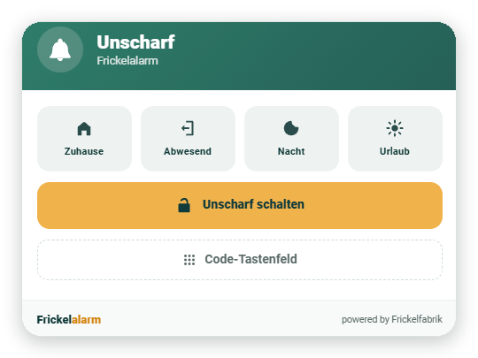
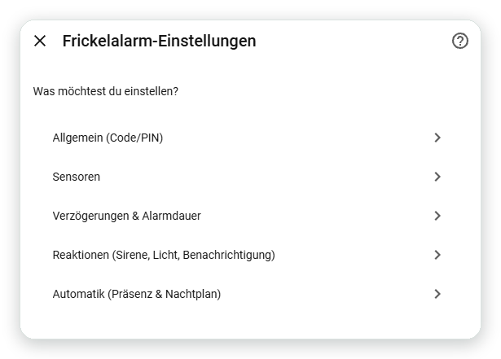
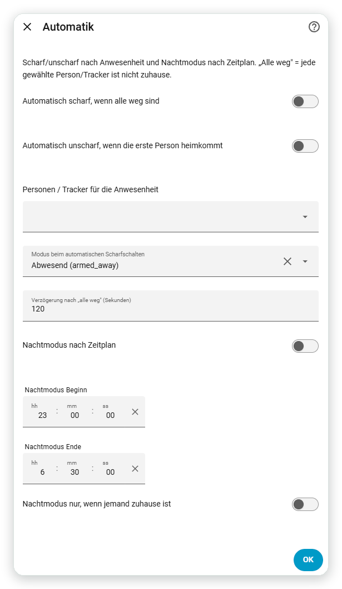

<p align="center">
  
</p>

<p align="center"><a href="README.md">English</a> · <b>Deutsch</b></p>

<p align="center">
  
  
  
  
  <a href="https://github.com/ankaios76/frickelalarm/actions/workflows/validate.yml"></a>
</p>

<p align="center">
  <b>Eine vollwertige Alarmanlage für Home Assistant – per Oberfläche eingerichtet, per Dienst (und damit per LLM über MCP) steuerbar.</b><br>
  Ausführliche Doku: <a href="https://frickelfabrik.de/blog/frickelalarm-doku/">Deutsch</a> · <a href="https://frickelfabrik.de/blog/frickelalarm-doku-en/">English</a>
</p>

<p align="center">
  
</p>

> **Status: 0.13.0 – öffentliche Beta.** Engine mit Reaktionen und Komfort, Präsenz-/Zeit-Automatik,
> eigene Lovelace-Karte und Sabotage-Erkennung – und als Einziges **per Dienst/LLM (MCP)
> konfigurierbar**. 0.13.0 härtet die Codes: **gehashte Speicherung** (kein Klartext),
> **persönliche und Gast-PINs** sowie **Aus-/Eingangsverzögerung je Modus**. Automatisierte
> Test-Suite und CI (hassfest + HACS + pytest). Siehe [CONCEPT.md](CONCEPT.md). Rückmeldungen und
> Tester sind ausdrücklich willkommen.

## Was schon funktioniert (0.13.0)

- Bedienfeld (`alarm_control_panel`) mit den Modi **Zuhause / Abwesend / Nacht / Urlaub**
- **Sensorauswahl je Modus**: pro Sensor festlegen, in welchen Modi er scharf ist
- **Ausgangsverzögerung** (Zeit zum Verlassen) → Zustand `arming`
- **Eingangsverzögerung** (Zeit zum Unscharfschalten) für „verzögerte" Sensoren → Zustand `pending`
- **Sofort-Sensoren** lösen ohne Verzögerung aus (z. B. Glasbruch)
- **„Immer scharf"**-Sensoren lösen in jedem Zustand aus – auch unscharf (z. B. Rauch/Sabotage)
- **Sabotage-/Signalverlust-Erkennung**: Meldung + Event `frickelalarm_tamper`, wenn ein Sensor
  unerreichbar wird, während die Anlage scharf ist
- **Offene Sensoren beim Scharfschalten**: wahlweise trotzdem scharf, offene umgehen & melden
  (werden beim Schließen automatisch wieder überwacht) oder Scharfschalten verhindern
- **Panik** (`frickelalarm.panic`), **Sirene verstummen** (`frickelalarm.silence`, Alarm läuft still
  weiter) und **„Jetzt scharf"** (`frickelalarm.skip_exit_delay`)
- **Alarmdauer**, danach automatisches Wiederschärfen in den vorherigen Modus
- **Reaktionen im Alarmfall**: gewählte Aktoren (Sirene/Licht/Schalter) gehen bei `triggered` an
  und danach wieder aus; optionale **Benachrichtigung** je Ereignis mit frei formulierbarem Text
- optionaler **Code/PIN**, getrennt für Scharf- und/oder Unscharfschalten – **gehasht gespeichert
  (PBKDF2), nie im Klartext**; bestehende Einträge werden automatisch migriert
- **Persönliche und Gast-PINs** (`add_pin` / `remove_pin`): zusätzliche Codes je Person, optional mit
  Ablaufdatum (Gast-PIN); bei jedem Auslösen/Unscharfschalten wird vermerkt, welcher Code gehandelt hat (`actor`)
- **Aus-/Eingangsverzögerung je Modus**: überschreibt die globale Verzögerung für einzelne Modi
  (z. B. „Nacht" sofort scharf, während „Abwesend" Zeit zum Verlassen lässt)
- **Mehrere Bereiche/Partitionen**: ein Eintrag = ein Bereich
- **Bypass**: Sensoren per Dienst (`frickelalarm.bypass` / `clear_bypass`) temporär ausklammern
  (gilt bis zum nächsten Unscharfschalten; „immer scharf"-Sensoren sind davon ausgenommen)
- **Logbuch-Events** für Automationen: `frickelalarm_armed/arming/pending/triggered/disarmed`
  (mit Bereich, Modus, Auslöser)
- **Sensor- und Aktoren-Übersicht** als Attribute (Live-Zustand, Modi, umgangene Sensoren an einem Ort)
- **Eigene Lovelace-Karte** (`custom:frickelalarm-card`) im Frickelfabrik-Look – wird von der
  Integration automatisch mit ausgeliefert und registriert (keine manuelle Ressource nötig);
  mit aktiver Modus-Hervorhebung, Countdown und optionalem **Zahlen-Tastenfeld**
- **Automatik**: **Auto-scharf**, wenn alle gewählten Personen weg sind (mit Verzögerung),
  **Auto-unscharf** bei Heimkehr der ersten Person, und **Nachtmodus nach Zeitplan**
- **Konfiguration per Dienst** (`add_sensor`, `remove_sensor`, `set_times`, `set_reactions`,
  `set_automation`, `add_pin`, `remove_pin`, `get_config`) – damit auch per LLM über den
  Home-Assistant-MCP-Server einrichtbar
- Zustand übersteht Neustarts – auch ein laufender Alarm, eine Verzögerung oder Bypass werden nach einem Neustart fortgesetzt

## Oberfläche

Alles wird menügeführt über die Oberfläche eingerichtet – Code/PIN, Sensoren, Verzögerungen,
Reaktionen und Automatik:

<p align="center">
  
</p>

Und die **Automatik** nach Anwesenheit und Nachtplan:

<p align="center">
  
</p>

## Qualität

- **Tests**: pytest-Suite (pytest-homeassistant-custom-component) für Config-Flow und Engine
- **CI**: GitHub Actions mit `hassfest`, HACS-Validierung und `pytest`
- **Icon/Logo** im `brand/`-Ordner (Frickelfabrik-Look)

## Automatik (Präsenz & Zeitplan)

Unter **Konfigurieren → Automatik**:

- **Auto-scharf**, wenn alle gewählten Personen/Tracker die Home-Zone verlassen haben –
  mit einstellbarer Verzögerung und wählbarem Modus. Kommt jemand während der Verzögerung
  zurück, wird nicht scharf geschaltet.
- **Auto-unscharf**, sobald die erste Person heimkommt – auch während Eingangsverzögerung
  oder laufendem Alarm.
- **Nachtmodus nach Zeitplan** (Beginn/Ende), optional nur wenn jemand zuhause ist.

Zur Laufzeit lassen sich die drei Schalter per Dienst `frickelalarm.set_automation` ein- und
ausschalten (auch per LLM/MCP). Der aktuelle Stand steht im Attribut `automatik` der Entität.

## Konfiguration per Dienst / MCP

Neben dem UI-Options-Flow lässt sich alles über Dienste einstellen – im Gegensatz zu vielen
anderen Lösungen also auch von einem LLM über den **Home-Assistant-MCP-Server** steuerbar:

- `frickelalarm.add_sensor` / `frickelalarm.remove_sensor`
- `frickelalarm.set_times` (Ein-/Ausgangsverzögerung, Alarmdauer)
- `frickelalarm.set_reactions` (Aktoren, Benachrichtigung)
- `frickelalarm.get_config` (liefert den aktuellen Stand zurück)
- `frickelalarm.bypass` / `frickelalarm.clear_bypass`

Alle Dienste zielen auf die Bereichs-Entität (`alarm_control_panel.…`). Beispiel:

```yaml
action: frickelalarm.add_sensor
target:
  entity_id: alarm_control_panel.haus_frickelalarm
data:
  sensor: binary_sensor.tuer_eingang
  modes: [armed_away, armed_night]
  delayed: true
```

## Lovelace-Karte

Die Karte wird automatisch registriert. Einfach eine **manuelle Karte** aufs Dashboard legen:

```yaml
type: custom:frickelalarm-card
entity: alarm_control_panel.haus_frickelalarm
name: Haus            # optional
keypad: collapsible   # optional: false (Standard) | true | collapsible
```

Sie zeigt Zustand (farbig), Countdown bei Ein-/Ausgangsverzögerung, Auslöser, offene und
umgangene Sensoren, die Modus-Knöpfe und – falls ein Code gesetzt ist – ein Code-Feld.

**Tastenfeld** (`keypad`): `false` = nur Textfeld (Standard), `true` = Zahlen-Tastenfeld immer
sichtbar, `collapsible` = über einen Knopf aufklappbar. Die eingegebenen Ziffern werden beim
Scharf-/Unscharfschalten als Code mitgeschickt.

## Was noch kommt

- Eintrag im `home-assistant/brands`-Repo, damit das Icon auch in der HA-Oberfläche
  erscheint, und Aufnahme in die Marketplace-Default-Liste

## Installation über HACS / Marketplace (Custom Repository)

> Seit Home Assistant **2026.11** ist HACS als **Marketplace** direkt in HA eingebaut
> (Einstellungen → Marketplace). Benutzerdefinierte Repositories funktionieren weiterhin.

1. **Marketplace** öffnen → oben rechts das Menü (⋮) → **Benutzerdefinierte Repositories**.
2. Repository `https://github.com/ankaios76/frickelalarm`, Kategorie **Integration**, hinzufügen.
3. „Frickelalarm" suchen, herunterladen, **Home Assistant neu starten**.
4. **Einstellungen → Geräte & Dienste → Integration hinzufügen → „Frickelalarm"**.

## Manuelle Installation

Ordner `custom_components/frickelalarm` in die Home-Assistant-Config kopieren, HA neu starten,
dann wie oben die Integration hinzufügen.

## Einrichten

1. Beim Hinzufügen: **Name** des Bereichs, optional **Code/PIN**.
2. Danach **Konfigurieren** (Zahnrad) öffnen – menügeführt:
   - **Sensoren**: Tür-/Fensterkontakte, Bewegungsmelder … auswählen. Pro Sensor: in welchen
     Modi scharf, „verzögert" (nutzt die Eingangsverzögerung), „immer scharf".
   - **Verzögerungen & Alarmdauer**: Ausgangs-/Eingangsverzögerung und Alarmdauer in Sekunden.
   - **Reaktionen**: Aktoren (Sirene/Licht/Schalter), die bei Alarm an- und danach ausgehen,
     sowie optional ein Benachrichtigungsdienst, Nachrichtentext und die Ereignisse dafür.
   - **Allgemein**: Code/PIN ändern.

## Voraussetzungen

Home Assistant **2026.2** oder neuer.

## Mitmachen

Das ist ein Hobby-/Lernprojekt der [Frickelfabrik](https://frickelfabrik.de). Ideen, Bug-Reports
und Tester sind willkommen – am besten über die
[Issues](https://github.com/ankaios76/frickelalarm/issues).
Es gibt mit **[Alarmo](https://github.com/nielsfaber/alarmo)** bereits eine ausgereifte,
sehr verbreitete Lösung mit ähnlichem Funktionsumfang – Frickelalarm entsteht bewusst eigen
(Lerneffekt, volle Kontrolle, eigene Akzente).

## Entwicklung

Repo: `~/projekte/frickelalarm`. Zum Testen `custom_components/frickelalarm` in die HA-Config
(`/home/norbert/homeassistant/config/custom_components/`) kopieren und
`docker restart homeassistant`. Logs: `docker logs homeassistant | grep -i frickelalarm`.

## Lizenz

MIT – siehe [LICENSE](LICENSE).
