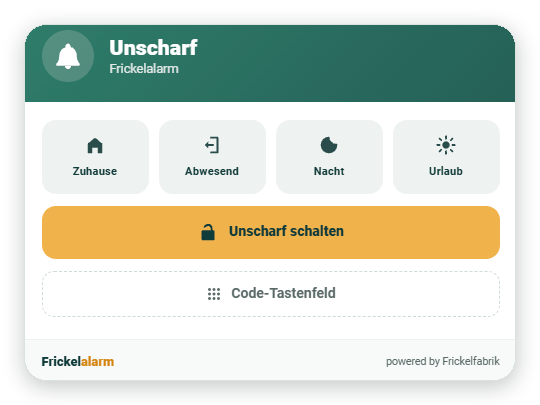
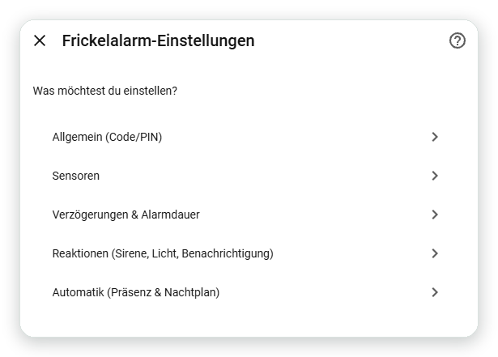
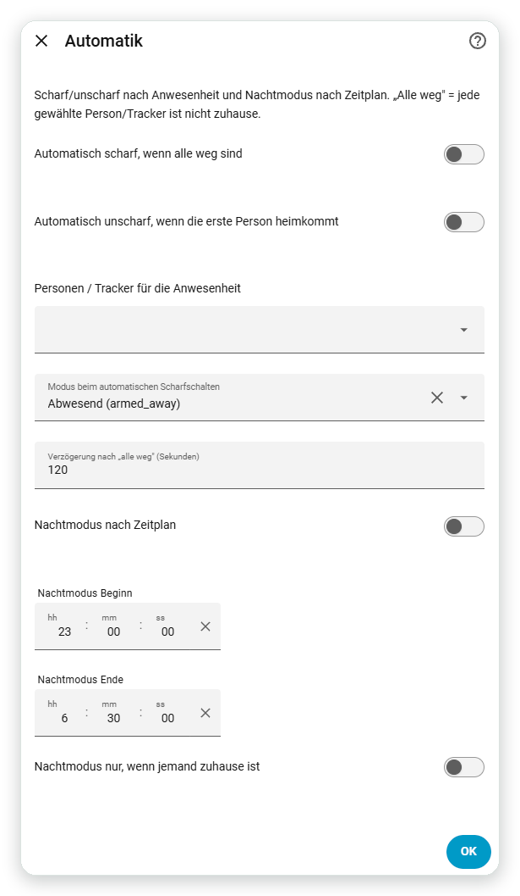

<p align="center">
  
</p>

<p align="center"><b>English</b> · <a href="README.de.md">Deutsch</a></p>

<p align="center">
  
  
  
  
  <a href="https://github.com/ankaios76/frickelalarm/actions/workflows/validate.yml"></a>
</p>

<p align="center">
  <b>A full alarm system for Home Assistant – set up through the UI, controllable through services (and therefore by an LLM via MCP).</b><br>
  Detailed docs: <a href="https://frickelfabrik.de/blog/frickelalarm-doku-en/">English</a> · <a href="https://frickelfabrik.de/blog/frickelalarm-doku/">Deutsch</a>
</p>

<p align="center">
  
</p>

> **Status: 0.11.0 – public beta.** Engine with reactions and convenience features, presence/time
> automation, its own Lovelace card and tamper detection – and, uniquely, **configurable through
> services / an LLM (MCP)**. Automated test suite and CI (hassfest + HACS + pytest). See
> [CONCEPT.md](CONCEPT.md) (German). Feedback and testers are very welcome.

## What already works (0.11.0)

- Control panel (`alarm_control_panel`) with the modes **Home / Away / Night / Vacation**
- **Per-mode sensor selection**: decide for each sensor which modes it is armed in
- **Exit delay** (time to leave) → state `arming`
- **Entry delay** (time to disarm) for "delayed" sensors → state `pending`
- **Instant sensors** trigger without a delay (e.g. glass break)
- **"Always armed"** sensors trigger in any state – even when disarmed (e.g. smoke/tamper)
- **Tamper / signal-loss detection**: notification + `frickelalarm_tamper` event when a sensor
  becomes unavailable while the system is armed
- **Open sensors when arming**: arm anyway, bypass & report (re-monitored automatically once closed),
  or block arming
- **Panic** (`frickelalarm.panic`), **silence siren** (`frickelalarm.silence`, alarm keeps running
  silently) and **"arm now"** (`frickelalarm.skip_exit_delay`)
- **Alarm duration**, then automatic re-arming to the previous mode
- **Reactions on alarm**: chosen actors (siren/light/switch) turn on at `triggered` and off again
  afterwards; optional **notification** per event with a freely worded message
- optional **code/PIN**, separately for arming and/or disarming
- **Multiple areas/partitions**: one entry = one area
- **Bypass**: temporarily exclude sensors via service (`frickelalarm.bypass` / `clear_bypass`)
  (until the next disarm; "always armed" sensors are exempt)
- **Logbook events** for automations: `frickelalarm_armed/arming/pending/triggered/disarmed`
  (with area, mode, trigger)
- **Sensor and actor overview** as attributes (live state, modes, bypassed sensors in one place)
- **Own Lovelace card** (`custom:frickelalarm-card`) in the Frickelfabrik look – shipped and
  registered automatically by the integration (no manual resource needed); with active-mode
  highlighting, countdown and an optional **number keypad**
- **Automation**: **auto-arm** when all chosen people have left (with a delay), **auto-disarm** when
  the first person returns, and **night mode on a schedule**
- **Configuration through services** (`add_sensor`, `remove_sensor`, `set_times`, `set_reactions`,
  `set_automation`, `get_config`) – so it can also be set up by an LLM via the Home Assistant MCP server
- State survives restarts

## Interface

Everything is set up menu-driven through the UI – code/PIN, sensors, delays, reactions and automation:

<p align="center">
  
</p>

And the **automation** by presence and night schedule:

<p align="center">
  
</p>

> Screenshots are from a German Home Assistant; the UI follows your HA user's language.

## Quality

- **Tests**: pytest suite (pytest-homeassistant-custom-component) for the config flow and the engine
- **CI**: GitHub Actions with `hassfest`, HACS validation and `pytest`
- **Icon/logo** in the `brand/` folder (Frickelfabrik look)

## Automation (presence & schedule)

Under **Configure → Automation**:

- **Auto-arm** when all chosen people/trackers have left the home zone – with an adjustable delay and
  a selectable mode. If someone returns during the delay, the system does not arm.
- **Auto-disarm** the moment the first person arrives – even during the entry delay or an alarm.
- **Night mode on a schedule** (start/end), optionally only when someone is home.

The three switches can be toggled at runtime via the `frickelalarm.set_automation` service (also via
LLM/MCP). The current state is exposed in the entity's `automatik` attribute.

## Configuration through services / MCP

Besides the UI options flow, everything can be set through services – which, unlike many other
solutions, means it can also be driven by an LLM via the **Home Assistant MCP server**:

- `frickelalarm.add_sensor` / `frickelalarm.remove_sensor`
- `frickelalarm.set_times` (exit/entry delay, alarm duration)
- `frickelalarm.set_reactions` (actors, notification)
- `frickelalarm.get_config` (returns the current state)
- `frickelalarm.bypass` / `frickelalarm.clear_bypass`

All services target the area entity (`alarm_control_panel.…`). Example:

```yaml
action: frickelalarm.add_sensor
target:
  entity_id: alarm_control_panel.house_frickelalarm
data:
  sensor: binary_sensor.front_door
  modes: [armed_away, armed_night]
  delayed: true
```

## Lovelace card

The card is registered automatically. Just add a **manual card** to the dashboard:

```yaml
type: custom:frickelalarm-card
entity: alarm_control_panel.house_frickelalarm
name: House           # optional
keypad: collapsible   # optional: false (default) | true | collapsible
```

It shows the state (in colour), a countdown during the exit/entry delays, the trigger, open and
bypassed sensors, the mode buttons and – if a code is set – a code field.

**Keypad** (`keypad`): `false` = text field only (default), `true` = number keypad always visible,
`collapsible` = expandable via a button. The entered digits are sent along as the code when
arming/disarming.

## Roadmap

- An entry in the `home-assistant/brands` repo so the icon also appears in the HA UI, and inclusion
  in the Marketplace default list

## Installation via HACS / Marketplace (custom repository)

> Since Home Assistant **2026.11**, HACS is built into HA as the **Marketplace**
> (Settings → Marketplace). Custom repositories still work.

1. Open the **Marketplace** → top-right menu (⋮) → **Custom repositories**.
2. Add the repository `https://github.com/ankaios76/frickelalarm`, category **Integration**.
3. Find "Frickelalarm", download it, **restart Home Assistant**.
4. **Settings → Devices & services → Add integration → "Frickelalarm"**.

## Manual installation

Copy the folder `custom_components/frickelalarm` into your Home Assistant config, restart HA, then add
the integration as above.

## Setup

1. When adding it: **name** of the area, optionally a **code/PIN**.
2. Then open **Configure** (gear icon) – menu-driven:
   - **Sensors**: pick door/window contacts, motion detectors … Per sensor: which modes it's armed
     in, "delayed" (uses the entry delay), "always armed".
   - **Delays & alarm duration**: exit/entry delay and alarm duration in seconds.
   - **Reactions**: actors (siren/light/switch) that turn on during an alarm and off afterwards, plus
     an optional notification service, message text and the events for it.
   - **General**: change the code/PIN.

## Requirements

Home Assistant **2026.2** or newer.

## Get involved

This is a hobby/learning project of the [Frickelfabrik](https://frickelfabrik.de). Ideas, bug reports
and testers are welcome – best via the
[issues](https://github.com/ankaios76/frickelalarm/issues).
There's already **[Alarmo](https://github.com/nielsfaber/alarmo)**, a mature and very popular solution
with a similar feature set – Frickelalarm is built from scratch on purpose (learning, full control,
a few own touches).

## Development

Repo: `~/projekte/frickelalarm`. For testing, copy `custom_components/frickelalarm` into the HA config
(`/home/norbert/homeassistant/config/custom_components/`) and run `docker restart homeassistant`.
Logs: `docker logs homeassistant | grep -i frickelalarm`.

## License

MIT – see [LICENSE](LICENSE).
